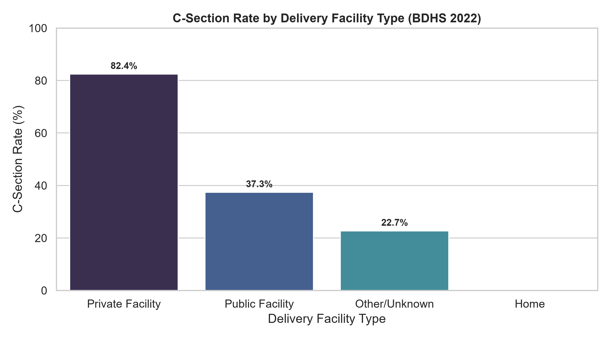
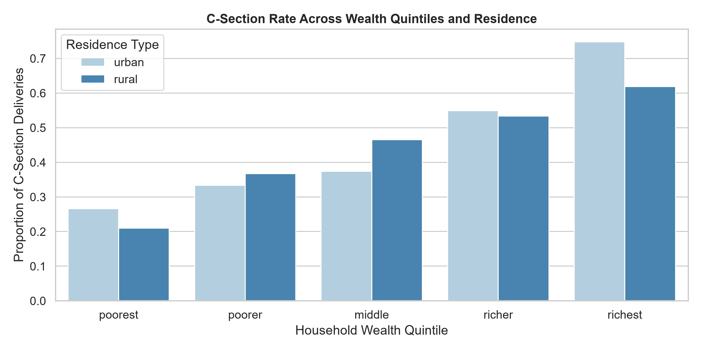
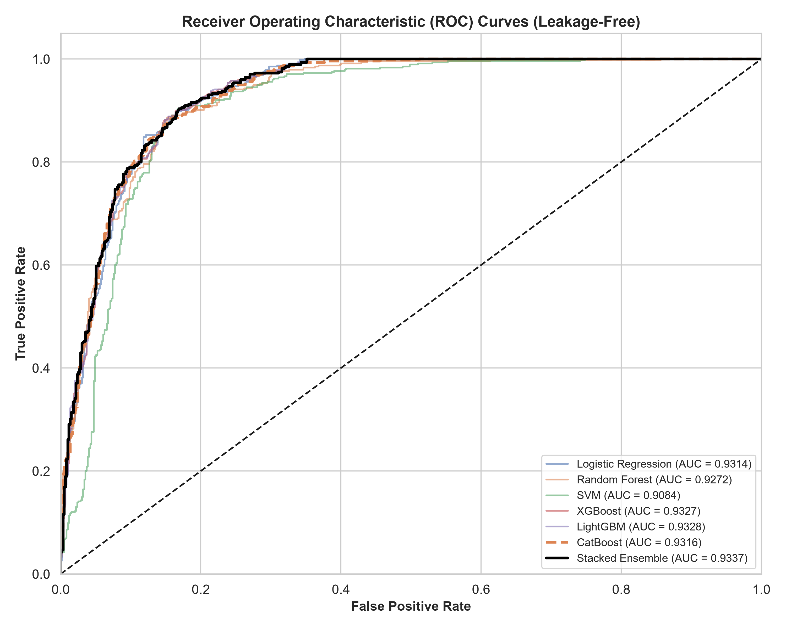
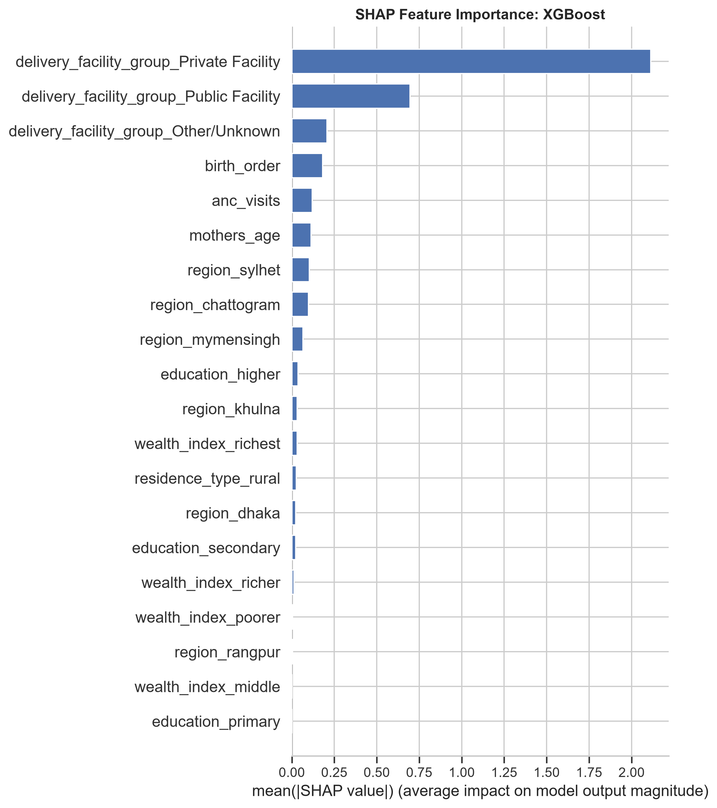
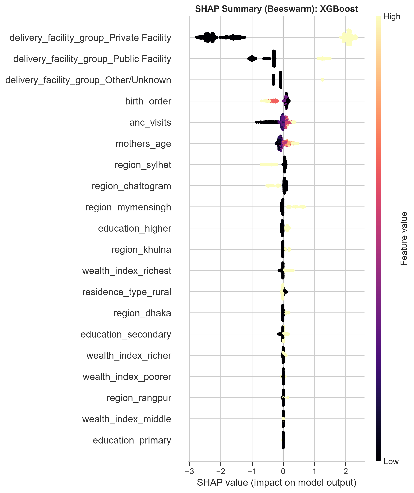
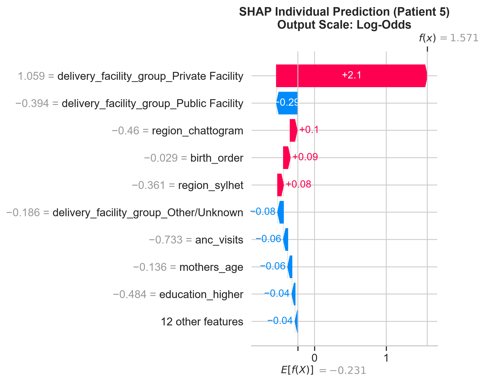
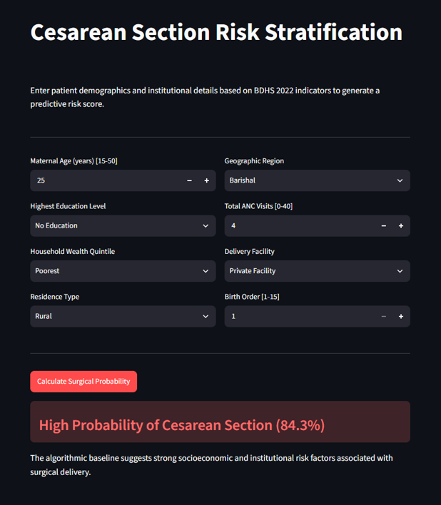

# An Explainable Framework for Predicting Cesarean Section Delivery Utilization Patterns in Bangladesh

BSc Computer Science thesis, De Montfort University (Module CTEC3451).

**Author:** Maidur Rahman Paiel (P2863751)  
**Supervisor:** Dr. Muhammad Waleed

This repository contains the code, trained models and figures for a machine learning study of recorded Cesarean delivery in Bangladesh, using the Bangladesh Demographic and Health Survey (BDHS) 2022. Seven classifiers are trained on routine sociodemographic, obstetric and healthcare-utilization features, and the best model (XGBoost) is explained with SHAP. A small Streamlit web app demonstrates the trained pipeline.

> **Not a clinical tool.** The BDHS contains no clinical indication variables, so the model cannot tell medically necessary from unnecessary surgeries. It is intended for population-level surveillance and research only, not for decisions about individual patients.

---

## Contents

- [Key results](#key-results)
- [Repository structure](#repository-structure)
- [Data access](#data-access)
- [Setup](#setup)
- [Running the analysis](#running-the-analysis)
- [Running the web app](#running-the-web-app)
- [Method summary](#method-summary)
- [Outputs and thesis figures](#outputs-and-thesis-figures)
- [Limitations](#limitations)
- [Citation](#citation)

---

## Key results

Performance on the 20% held-out test set (1,067 deliveries):

| Model | Accuracy | Precision | Recall | F1 | ROC AUC |
|---|---|---|---|---|---|
| Logistic Regression | 0.8604 | 0.8159 | 0.8863 | 0.8496 | 0.9314 |
| Random Forest | 0.8613 | 0.8263 | 0.8716 | 0.8484 | 0.9272 |
| SVM (RBF) | 0.8632 | 0.8182 | 0.8905 | 0.8528 | 0.9083 |
| **XGBoost** | **0.8650** | **0.8264** | 0.8821 | **0.8534** | 0.9327 |
| LightGBM | 0.8641 | 0.8248 | 0.8821 | 0.8525 | 0.9328 |
| CatBoost | 0.8604 | 0.8159 | 0.8863 | 0.8496 | 0.9316 |
| Stacked Ensemble | 0.8566 | 0.8207 | 0.8674 | 0.8433 | 0.9337 |

- The models performed very similarly. XGBoost was selected for interpretation because it had the highest Accuracy, Precision and F1 Score and is natively supported by SHAP TreeExplainer.
- **Delivery facility type was by far the strongest predictor.** Private facility delivery contributed most strongly toward a predicted Cesarean delivery. Household wealth contributed more modestly, largely through its association with facility choice.
- **Sensitivity analysis:** with all facility features removed, XGBoost ROC AUC fell from 0.9327 to 0.7446 and Recall from 0.8821 to 0.5537.

### Cesarean rates in the analytic cohort

82.4% of deliveries in private facilities were Cesarean, compared with 37.3% in public facilities and none of the 1,923 home births. Rates also rise steeply with household wealth.

<p align="center">
  
  
</p>

### Model discrimination

All seven models reach a ROC AUC between 0.91 and 0.93 on the held-out test set.

<p align="center">
  
</p>

### What drives the XGBoost predictions (SHAP)

The left plot ranks features by their average impact. The right plot shows the direction: points to the right push a prediction toward Cesarean, and yellow means the feature value is high (for facility features, the mother delivered there). Home birth is the reference category for the facility features.

<p align="center">
  
  
</p>

An individual explanation for one test patient, who was correctly predicted as Cesarean (82.8%). Private facility delivery added +2.1 to the log-odds:

<p align="center">
  
</p>

---

## Repository structure

```
Thesis_dir/
├── notebooks/
│   ├── Thesis_master_notebook.ipynb   # Full pipeline: cohort → cleaning → EDA → encoding →
│   │                                  #   audit → training → evaluation → SHAP
│   └── app.py                         # Streamlit web interface (Chapter 5)
├── data/
│   ├── raw/                           # BDHS 2022 files (NOT included, see Data access)
│   └── processed/                     # Generated by the notebook (NOT included)
│       ├── bdhs_2022_encoded.csv      #   One-hot encoded analytic cohort
│       └── model_full_cv_results.csv  #   Test-set metrics for all seven models
├── src/
│   └── models/                        # Serialized scikit-learn pipelines (joblib)
│       ├── xgboost_pipeline.pkl       #   Used by the web app
│       ├── logistic_regression_pipeline.pkl
│       ├── random_forest_pipeline.pkl
│       ├── svm_pipeline.pkl
│       ├── lightgbm_pipeline.pkl
│       ├── catboost_pipeline.pkl
│       └── stacked_ensemble.pkl
├── figures/
│   ├── fig1_facility_csection_rate.png
│   ├── fig2_wealth_residence_trends.png
│   ├── fig3_class_distribution.png
│   ├── final_results/
│   │   ├── fig5_roc_curves_final.png
│   │   ├── fig6_confusion_matrices_final.png
│   │   ├── fig6_shap_waterfall_xgboost.png
│   │   └── shap/                      # SHAP bar and beeswarm plots for every model
│   └── app/
│       └── app_demo.png               # Screenshot of the web app (used in this README)
├── requirements.txt
└── README.md
```

---

## Data access

The BDHS 2022 microdata **cannot be redistributed** under the DHS Program data use agreement, so no raw or processed data is included in this repository (see `.gitignore`).

To reproduce the analysis:

1. Register at the [DHS Program website](https://dhsprogram.com/data/) and request access to the **Bangladesh 2022 Standard DHS** dataset.
2. Download the **Children's Recode (KR)** in **Stata** format (`BDKR81DT.ZIP`).
3. Extract it so that this file exists:

   ```
   data/raw/BDKR81DT/BDKR81FL.DTA
   ```

Only the Children's Recode is used by the notebook. Other BDHS files (Individual Recode, Household Member Recode, GPS and covariates) are not required.

---

## Setup

Tested with **Python 3.13** on Windows 11.

```bash
# 1. Create and activate a virtual environment
python -m venv venv
venv\Scripts\activate          # Windows
# source venv/bin/activate     # macOS / Linux

# 2. Install dependencies
pip install -r requirements.txt
```

`requirements.txt` pins the exact versions used to produce the thesis results.

---

## Running the analysis

Open `notebooks/Thesis_master_notebook.ipynb` in Jupyter or VS Code and **run all cells from top to bottom**. The notebook uses relative paths (`../data`, `../figures`, `../src/models`), so it must be run from inside the `notebooks/` folder.

| Notebook section | What it does | Main outputs |
|---|---|---|
| 1. Data Acquisition | Loads the KR file and keeps births with a recorded delivery mode (`m17`) | Cohort of 5,331 deliveries |
| 2. Data Cleaning | Groups delivery place into Private / Public / Home / Other-Unknown; sets ANC "don't know" codes to missing | Cleaned cohort |
| 3. EDA | Cesarean rates by facility, wealth and residence | `figures/fig1–fig3` |
| 4. Encoding | One-hot encoding (`drop_first=True`), 21 features | `data/processed/bdhs_2022_encoded.csv` |
| 4.1 Related-Record Audit | Counts repeat mothers and households, and overlap across the train/test split | Printed audit |
| 5. Model Training | 80/20 stratified split, 10-fold grid search, leakage-free pipelines, stacking | `src/models/*.pkl`, `model_full_cv_results.csv` |
| 6. Evaluation & SHAP | ROC curves, confusion matrices, SHAP plots for every model | `figures/final_results/` |
| 7. Sensitivity Analysis | Retrains XGBoost without facility features | Printed metrics |
| 8. Local Interpretability | SHAP waterfall plot for one test patient | `fig6_shap_waterfall_xgboost.png` |

The full run takes several minutes, mostly for the SVM grid search and the stacked ensemble.

---

## Running the web app

The app loads `../src/models/xgboost_pipeline.pkl`, so either train the models first (section 5 of the notebook) or use the included pipeline. Run it from inside `notebooks/`:

```bash
cd notebooks
streamlit run app.py
```

Then open the local URL that Streamlit prints (usually http://localhost:8501). Enter maternal age, education, wealth quintile, residence, region, ANC visits, delivery facility and birth order. The app returns the predicted probability of a Cesarean delivery, using a 50% threshold for the alert.

<p align="center">
  
</p>

---

## Method summary

- **Data:** BDHS 2022 Children's Recode. 5,331 deliveries from the three years before the survey (2,374 Cesarean, 44.5%; 2,957 vaginal). Unweighted, so rates describe the sample, not the national population.
- **Features (8):** maternal age, education, household wealth quintile, residence, region, ANC visits, delivery facility, birth order. These become 21 columns after one-hot encoding.
- **Preprocessing:** one-hot encoding before the split (a fixed mapping, so no leakage). Median imputation (ANC visits) and standard scaling are fitted on training data only, inside scikit-learn pipelines.
- **Models:** Logistic Regression, Random Forest, SVM, XGBoost, LightGBM, CatBoost and a Stacked Ensemble (out-of-fold predictions, Logistic Regression meta-learner).
- **Validation:** 80/20 stratified train/test split; hyperparameters tuned by 10-fold stratified cross-validation (`GridSearchCV`, accuracy scoring); `random_state=42` throughout.
- **Interpretability:** SHAP TreeExplainer on XGBoost (global bar and beeswarm plots, plus a local waterfall plot).

---

## Outputs and thesis figures

| File | Thesis figure |
|---|---|
| `figures/fig3_class_distribution.png` | Figure 3.2 |
| `figures/fig1_facility_csection_rate.png` | Figure 4.1 |
| `figures/fig2_wealth_residence_trends.png` | Figure 4.2 |
| `figures/final_results/fig5_roc_curves_final.png` | Figure 4.3 |
| `figures/final_results/fig6_confusion_matrices_final.png` | Figure 4.4 |
| `figures/final_results/shap/xgboost_bar.png` and `xgboost_swarm.png` | Figure 4.5 |
| `figures/final_results/fig6_shap_waterfall_xgboost.png` | Figure 4.6 |

---

## Limitations

- **No clinical indications:** the model predicts *recorded* delivery mode and cannot judge whether a surgery was medically necessary.
- **Delivery facility is known only at delivery,** and no home births were Cesarean, so this feature partly reflects the delivery itself. Without it, ROC AUC drops to 0.7446, and the model cannot predict delivery mode before the place of delivery is known.
- **Related records:** 272 mothers contributed more than one delivery. 8.4% of test records belong to a mother who also appears in training, so test performance may be slightly optimistic.
- **Unweighted sample:** survey weights were not applied, so results are not national estimates.
- **Correlated features:** wealth and private facility use are strongly correlated. SHAP explains how the model used them, not their causal effect.
- **Self-reported survey data** may contain recall bias.

---

## Citation

If you refer to this work, please cite:

> Paiel, M. R. (2026). *An Explainable Framework for Predicting Cesarean Section Delivery Utilization Patterns in Bangladesh*. BSc Computer Science thesis, De Montfort University.

Data source:

> National Institute of Population Research and Training (NIPORT) and ICF. (2023). *Bangladesh Demographic and Health Survey 2022: Key Indicators Report*. Dhaka, Bangladesh, and Rockville, Maryland, USA: NIPORT and ICF.

This repository accompanies an academic thesis. No open-source licence has been applied; please contact the author before reusing the code.
